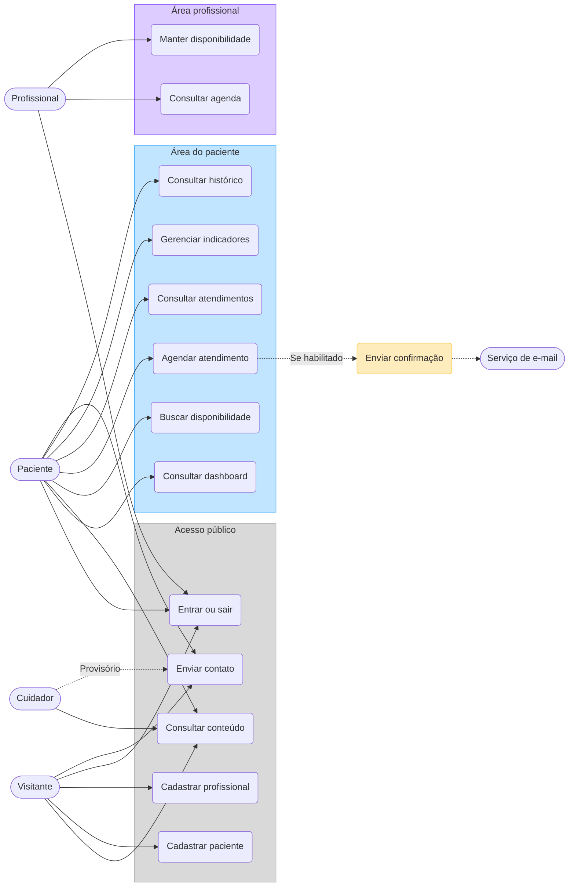

# Casos de uso do Vida+Fácil

## Objetivo

Representar como os atores interagem com as capacidades previstas para o MVP e ligar cada interação aos requisitos especificados.

## Atores

| Ator | Descrição | Limite atual |
| --- | --- | --- |
| Visitante | Pessoa sem sessão autenticada. | Acessa início, conteúdo público, cadastro, login e contato. |
| Paciente | Pessoa autenticada que utiliza o serviço para si. | Gerencia apenas os próprios agendamentos e indicadores. |
| Cuidador | Público previsto, ainda sem regra funcional aprovada. | Acesso apenas ao conteúdo público e, provisoriamente, ao contato. Não acessa dados de terceiros. |
| Profissional | Pessoa autenticada com perfil, especialidade e registro profissional. | Mantém a própria disponibilidade e consulta apenas a própria agenda. |
| Serviço de e-mail | Integração externa opcional. | Só participa se houver infraestrutura e credenciais aprovadas. |

## Diagrama geral

As linhas tracejadas representam interações condicionais ou ainda pendentes de decisão.

## Catálogo

| ID | Caso de uso | Ator principal | Estado | Requisitos |
| --- | --- | --- | --- | --- |
| UC-01 | Consultar início e conteúdo educativo | Visitante, paciente e cuidador | Confirmado | RF-01, RF-02, RNF-08 |
| UC-02 | Cadastrar paciente | Visitante | Refinado | RF-03, RNF-03, RNF-04, RNF-06 |
| UC-03 | Cadastrar profissional | Visitante | Refinado | RF-04, RNF-03, RNF-04, RNF-06 |
| UC-04 | Entrar e sair | Paciente e profissional | Confirmado | RF-05, RNF-04 |
| UC-05 | Consultar dashboard | Paciente | Confirmado | RF-06 |
| UC-06 | Buscar disponibilidade | Paciente | Refinado | RF-07 |
| UC-07 | Agendar atendimento | Paciente | Confirmado | RF-08, RN-03, RN-04 |
| UC-08 | Consultar atendimentos | Paciente e profissional | Refinado | RF-09, RNF-05 |
| UC-09 | Manter disponibilidade | Profissional | Refinado | RF-10, RN-03, RN-09 |
| UC-10 | Gerenciar indicadores | Paciente | Confirmado | RF-11, RF-12, RN-02, RN-05, RNF-07 |
| UC-11 | Consultar histórico de indicadores | Paciente | Confirmado | RF-12, RNF-08 |
| UC-12 | Enviar contato | Visitante e paciente | Confirmado | RF-13 |
| UC-13 | Enviar confirmação de agendamento | Serviço de e-mail | Condicional | RF-14 |

## Especificações dos fluxos essenciais

### UC-02 — Cadastrar paciente

**Pré-condição:** a pessoa não precisa estar autenticada.

**Fluxo principal:**

1. visitante escolhe criar conta de paciente;
2. sistema apresenta os campos mínimos e suas instruções;
3. visitante preenche os dados e solicita o cadastro;
4. sistema valida os dados no cliente e no servidor;
5. sistema protege a senha e cria a conta com perfil de paciente;
6. sistema confirma o cadastro e oferece acesso ao login.

**Alternativas:** campos inválidos são preservados quando seguro e recebem mensagens específicas; e-mail já utilizado não cria uma segunda conta e recebe orientação sem expor outros dados.

**Pós-condição:** existe uma conta de paciente apta a autenticar.

### UC-03 — Cadastrar profissional

**Pré-condição:** a pessoa não precisa estar autenticada.

**Fluxo principal:**

1. visitante escolhe criar conta de profissional;
2. sistema apresenta nome, telefone, e-mail, senha, especialidade e registro profissional;
3. visitante informa também um ou mais horários disponíveis, identificados por dia e horário;
4. sistema valida os dados no cliente e no servidor;
5. sistema protege a senha, cria a conta com perfil profissional e registra os horários estruturados;
6. sistema confirma o cadastro e oferece acesso ao login.

**Alternativas:** e-mail ou registro profissional já utilizado não criam uma segunda conta; dia ou horário inválido não é salvo e recebe orientação clara.

**Pós-condição:** existe uma conta profissional apta a autenticar, com disponibilidade inicial válida.

### UC-04 — Entrar e sair

**Pré-condição:** conta cadastrada e ativa.

**Fluxo principal:**

1. pessoa informa suas credenciais;
2. sistema valida as credenciais;
3. sistema inicia uma sessão associada ao perfil autorizado;
4. sistema direciona a pessoa para sua área;
5. ao escolher sair, sistema encerra a sessão e retorna à área pública.

**Alternativas:** credenciais inválidas não iniciam sessão e recebem mensagem genérica; rota privada sem sessão direciona ao login sem exibir conteúdo protegido.

**Pós-condição:** sessão ativa após entrada válida ou sessão encerrada após saída.

### UC-07 — Agendar atendimento

**Pré-condições:** paciente autenticado; profissional e horário disponíveis.

**Fluxo principal:**

1. paciente filtra por especialidade e data;
2. sistema lista profissionais e horários compatíveis;
3. paciente escolhe um horário;
4. sistema apresenta resumo com profissional, especialidade, data e horário;
5. paciente confirma;
6. sistema verifica novamente a disponibilidade;
7. sistema cria o agendamento e remove o horário das opções livres;
8. sistema apresenta confirmação no portal;
9. se habilitado, o serviço externo envia a confirmação por e-mail.

**Alternativas:** ausência de resultado informa como alterar os filtros; horário ocupado durante a confirmação não cria agendamento e solicita nova escolha; falha de e-mail não desfaz o agendamento e mantém a confirmação no portal.

**Pós-condição:** existe um único agendamento associado ao paciente e ao profissional naquele horário.

### UC-08 — Consultar atendimentos

**Pré-condição:** paciente ou profissional autenticado.

**Fluxo principal do paciente:**

1. paciente abre a área de atendimentos;
2. sistema lista somente os agendamentos vinculados à sua conta, em ordem de data e horário;
3. paciente consulta o resumo do profissional, especialidade, data e horário.

**Fluxo principal do profissional:**

1. profissional abre a agenda;
2. sistema lista somente os agendamentos associados à sua disponibilidade;
3. profissional consulta a agenda por data e horário.

**Alternativas:** quando não houver agendamento, o sistema informa o estado vazio sem exibir dados de outra pessoa.

**Pós-condição:** cada perfil visualiza apenas os atendimentos autorizados.

### UC-09 — Manter disponibilidade

**Pré-condição:** profissional autenticado com perfil profissional ativo.

**Fluxo principal:**

1. profissional abre a área de disponibilidade;
2. sistema apresenta os próprios horários futuros, identificados por dia, início e fim;
3. profissional cria, edita ou solicita a remoção de um horário;
4. sistema valida o período e a propriedade do horário;
5. sistema grava a alteração e apresenta uma confirmação curta e clara.

**Alternativas:** horários sobrepostos, passados ou inválidos não são gravados; horário com agendamento não é removido silenciosamente e recebe orientação sobre a ação permitida.

**Pós-condição:** a disponibilidade futura do profissional reflete somente alterações válidas feitas pela própria conta.

### UC-10 — Gerenciar indicadores

**Pré-condição:** paciente autenticado.

**Fluxo principal de registro:**

1. paciente escolhe o tipo de indicador;
2. sistema apresenta campos e unidade compatíveis;
3. paciente informa valor e data da medição;
4. sistema valida formato, tipo, unidade e data;
5. sistema grava o registro vinculado ao paciente;
6. sistema confirma a operação e atualiza listagem e histórico.

**Alternativas:** valor, unidade ou data inválidos não são gravados e recebem explicação; edição repete as validações; exclusão solicita confirmação e só remove registro pertencente ao paciente.

**Pós-condição:** listagem e gráfico refletem somente registros válidos do paciente autenticado.

### UC-12 — Enviar contato

**Pré-condição:** nenhuma para o visitante; identidade autenticada pode preencher dados já conhecidos.

**Fluxo principal:**

1. pessoa abre o formulário;
2. informa nome, meio de contato, assunto e mensagem;
3. sistema valida os campos;
4. pessoa confirma o envio;
5. sistema processa a mensagem pelo mecanismo aprovado;
6. sistema apresenta confirmação clara.

**Alternativas:** erros de preenchimento são associados aos campos; falha no processamento mantém os dados não sensíveis necessários à correção e oferece nova tentativa.

**Pós-condição:** mensagem processada ou falha comunicada sem simular sucesso.

## Fluxos consolidados por perfil

### Paciente

`Cadastro de paciente → Login → Dashboard → Buscar especialidade, profissional e horário → Confirmar agendamento → Consultar atendimentos`

Em paralelo ou depois do agendamento, o paciente pode seguir `Dashboard → Indicadores → Criar, editar ou excluir registro → Consultar histórico`. A área de conteúdo educativo e o contato permanecem acessíveis sem depender desse fluxo.

### Profissional

`Cadastro profissional → Login → Painel profissional → Manter disponibilidade → Consultar agenda`

O profissional informa especialidade, registro e horários por dia e horário. As operações de disponibilidade e agenda ficam restritas à própria conta; o fluxo não concede acesso aos indicadores de saúde do paciente.

## Casos de uso bloqueados por decisão

Não foram incluídos casos de uso para vínculo de cuidador, acesso delegado, medicamentos, cancelamento e reagendamento. Esses fluxos dependem das dúvidas D01, D02, D03 e D05 da matriz CSD.
