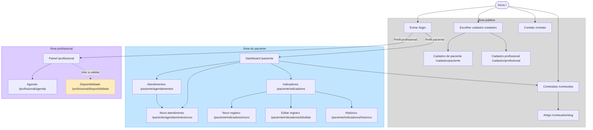

# Mapa de navegação do Vida+Fácil

## Objetivo

Organizar as páginas e os caminhos essenciais do MVP antes da criação dos wireframes, mantendo separadas as áreas pública, do paciente e do profissional.

## Decisão de escopo

O Projeto-Teste usa a expressão “mapa de navegação/jornada do cliente” e a matriz aceita mapa **ou** jornada. Para esta entrega foi adotado o mapa de navegação, pois ele cobre diretamente as telas e relações necessárias ao Módulo B. Os dois fluxos críticos são descritos ao final para preservar a visão sequencial sem criar um segundo artefato não confirmado como obrigatório.

Os caminhos abaixo são propostas de arquitetura da informação. Eles poderão ser ajustados no design e não constituem ainda rotas implementadas.

## Diagrama

## Inventário de páginas

| Área | Página proposta | Acesso | Objetivo | Requisitos |
| --- | --- | --- | --- | --- |
| Pública | Início | Todos | Apresentar o Vida+Fácil e os caminhos principais. | RF-01 |
| Pública | Conteúdos | Todos | Listar e localizar conteúdo educativo. | RF-02 |
| Pública | Detalhe de conteúdo | Todos | Ler ou assistir a um conteúdo selecionado. | RF-02, RNF-08 |
| Pública | Escolher cadastro | Todos | Explicar a diferença entre paciente e profissional. | RF-03, RF-04 |
| Pública | Cadastro de paciente | Visitante | Criar conta de paciente com dados mínimos. | RF-03 |
| Pública | Cadastro profissional | Visitante | Criar conta com especialidade e registro. | RF-04 |
| Pública | Entrar | Visitante | Iniciar sessão e direcionar conforme o perfil. | RF-05 |
| Pública | Contato | Todos | Enviar uma mensagem e receber retorno da operação. | RF-13 |
| Paciente | Dashboard | Paciente | Resumir o serviço e dar acesso às ações essenciais. | RF-06 |
| Paciente | Atendimentos | Paciente | Consultar os próprios atendimentos. | RF-09 |
| Paciente | Novo atendimento | Paciente | Filtrar opções, escolher horário e confirmar. | RF-07, RF-08, RF-14 |
| Paciente | Indicadores | Paciente | Listar e gerenciar os próprios registros. | RF-11, RF-12 |
| Paciente | Novo indicador | Paciente | Registrar uma medição válida. | RF-11 |
| Paciente | Editar indicador | Paciente | Corrigir um registro próprio. | RF-12 |
| Paciente | Histórico | Paciente | Consultar série temporal e gráfico por indicador. | RF-12, RNF-08 |
| Profissional | Painel | Profissional | Dar acesso à agenda e às funções autorizadas. | RF-09 |
| Profissional | Agenda | Profissional | Consultar atendimentos relacionados ao perfil. | RF-09 |
| Profissional | Disponibilidade | Ator a validar | Criar ou remover horários futuros. | RF-10 |

## Navegação global proposta

### Sem sessão

- logotipo com retorno ao início;
- conteúdos;
- contato;
- criar conta;
- entrar.

### Paciente autenticado

- dashboard;
- atendimentos;
- indicadores;
- conteúdos;
- sair.

### Profissional autenticado

- painel;
- agenda;
- disponibilidade, somente após confirmação da responsabilidade;
- sair.

Não foi criada navegação autenticada para cuidador. Esse perfil poderá usar a área pública, mas qualquer acesso a dados de outra pessoa depende de vínculo, consentimento e permissões ainda não definidos.

## Regras de navegação e acessibilidade

1. cada página deve possuir um título principal único e descritivo;
2. o primeiro mecanismo repetido deve oferecer opção para pular ao conteúdo principal;
3. menus devem ser operáveis por teclado e indicar a página atual por texto ou semântica, não apenas por cor;
4. ao entrar, a pessoa deve ser direcionada somente para a área compatível com seu perfil;
5. tentativa de acessar rota privada sem sessão deve preservar um destino seguro e solicitar autenticação;
6. tentativa de acessar rota de outro perfil deve ser recusada sem revelar dados;
7. formulários concluídos devem mover ou anunciar o foco para a confirmação ou para o resumo de erros;
8. páginas de detalhe e edição devem oferecer retorno perceptível à listagem correspondente;
9. carregamento, vazio, sucesso e erro devem possuir mensagens textuais;
10. o encerramento de sessão deve retornar a uma página pública e impedir o uso da sessão anterior.

## Fluxo crítico 1 — Agendamento

`Entrar → Dashboard → Novo atendimento → Filtrar opções → Escolher horário → Revisar → Confirmar → Ver confirmação → Consultar atendimentos`

Pontos de retorno: ausência de resultados retorna aos filtros; conflito na confirmação retorna à escolha de horário; falha de e-mail não remove o agendamento confirmado.

## Fluxo crítico 2 — Indicadores

`Entrar → Dashboard → Indicadores → Novo registro → Validar dados → Confirmar → Ver listagem → Consultar histórico`

Pontos de retorno: erro de validação mantém os dados seguros no formulário; edição e exclusão retornam à listagem com confirmação anunciada.

## Páginas não incluídas

- área privada do cuidador;
- vínculo e consentimento entre cuidador e paciente;
- medicamentos e lembretes;
- cancelamento e reagendamento;
- área administrativa;
- interpretação clínica de indicadores.
